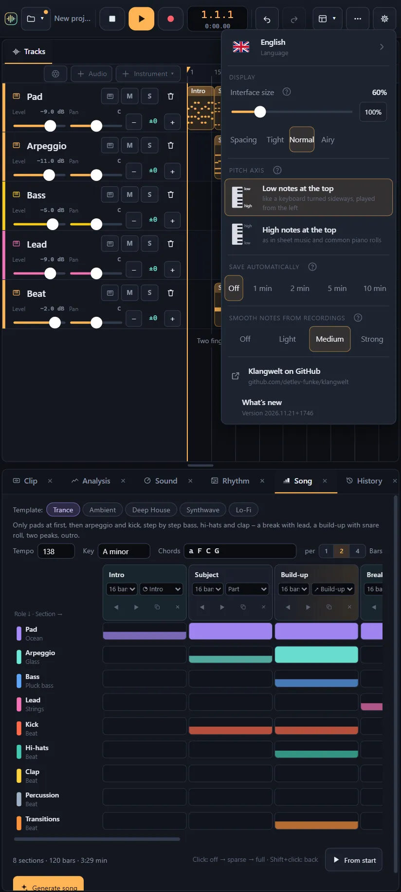
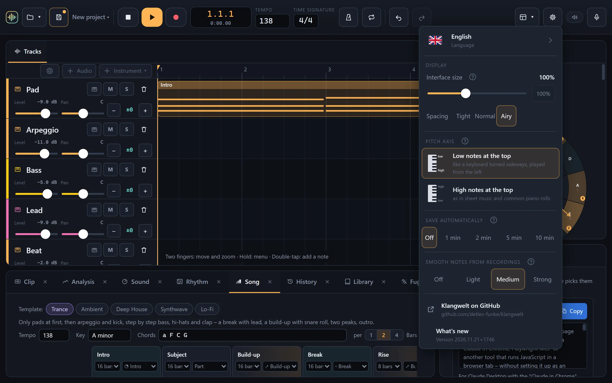
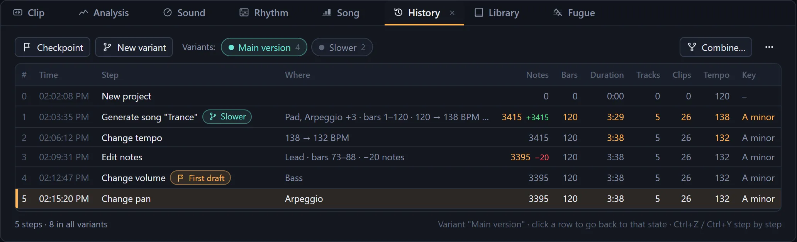
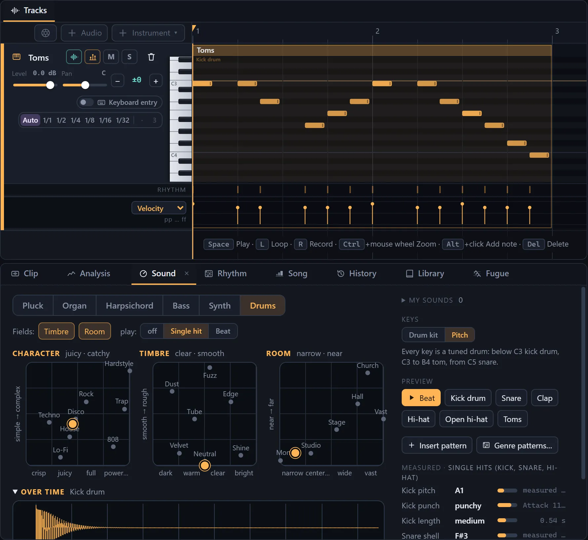
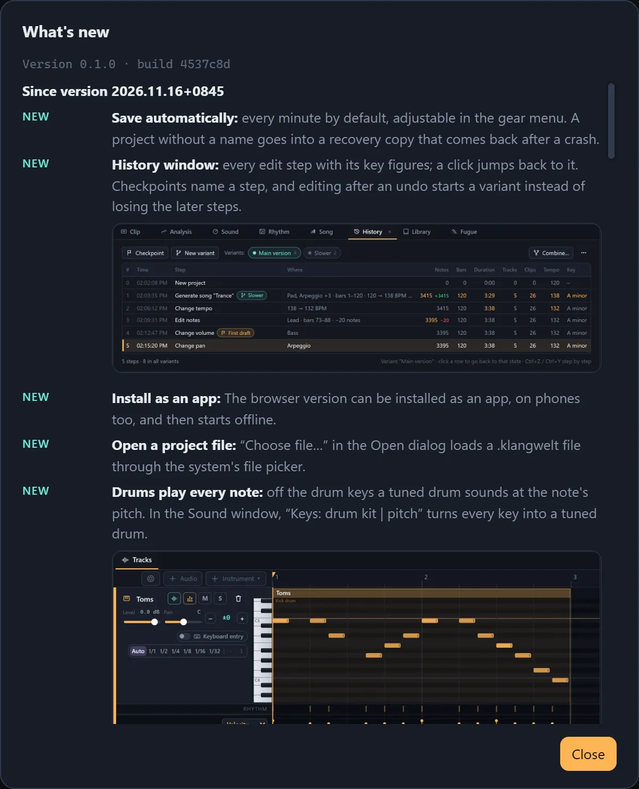
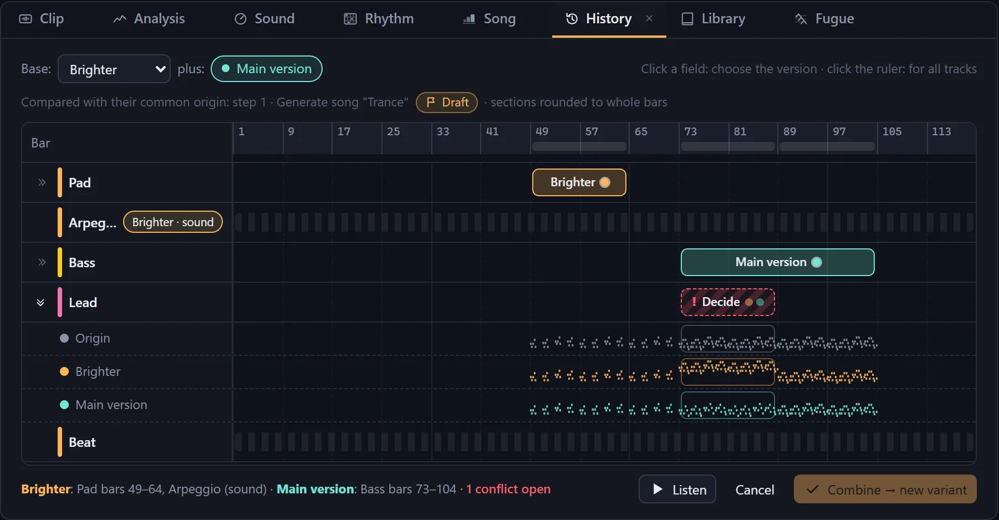
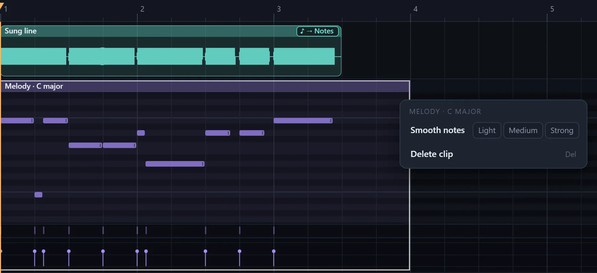
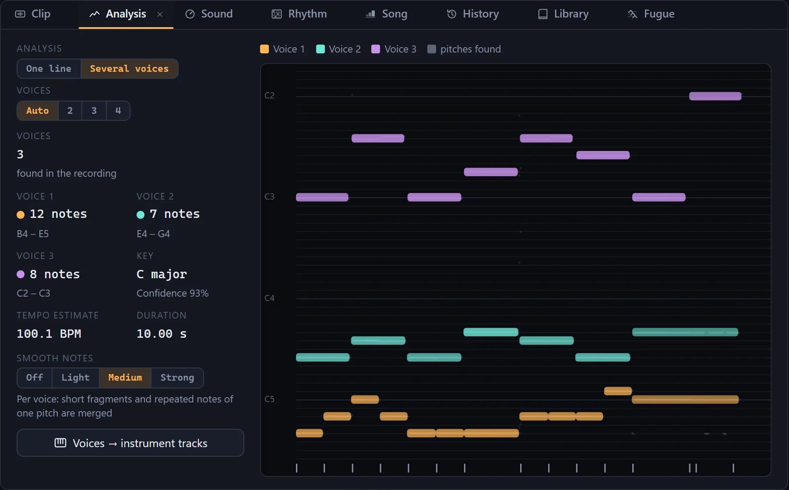
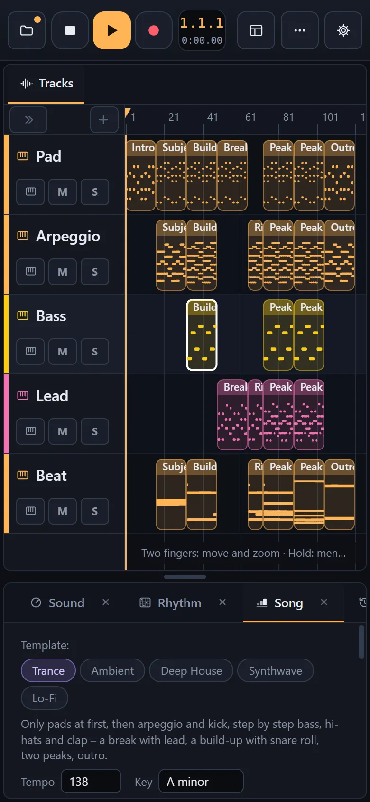
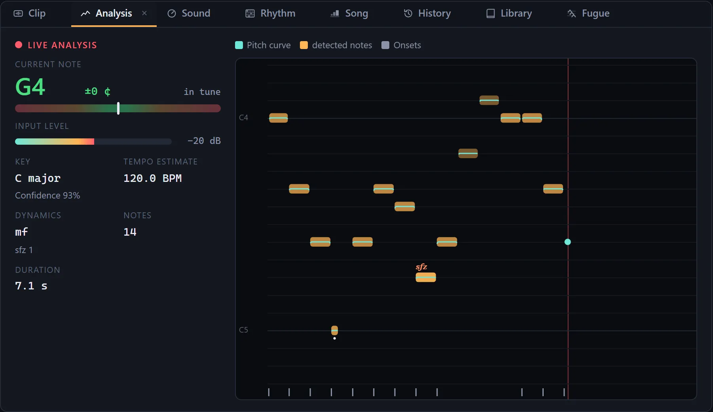

# Changelog

All notable changes to Klangwelt. The browser version and the desktop app share
one version number: the date and time of the release, so `2026.11.21+1430` is
21 November 2026, 14:30. The format follows
[Keep a Changelog](https://keepachangelog.com/en/1.1.0/).

This file is generated from the JSON files in [changelog/](changelog/README.md),
which also says how to add an entry. The app shows the same entries in its own
language under the gear menu → What's new.

## [2026.11.21+2051] - 2026-11-21 20:51

### Fixed

- **New versions show up at once:** after an update, Klangwelt in the browser and as an installed app no longer starts once more in the old version. If you haven't touched anything yet, it switches to the new one at once; otherwise a note offers “Reload” – your project comes along either way. This also lets the browser install the app again where it saw no manifest. *(browser only)*
  - Technical: web/host.ts reports a worker taking over from an earlier one, update.ts reloads through autosave.ts reloadKeepingProject (shared with the language switch) or shows a note; sw.ts installs with cache: "reload" so no file comes from the browser's HTTP cache.

## [2026.11.21+1959] - 2026-11-21 19:59

### Added

- **Klangwelt on GitHub:** The gear menu leads to the project page: source code, releases, questions and ideas.
  - Technical: The desktop app opens it in the system's browser (open_url in lib.rs, https only).
- **Interface size:** A slider in the gear menu (Display) makes everything smaller or larger, from 40 to 200 %: smaller shows more at once, on a phone with a stylus for example. Remembered on each device; in a browser on a computer its own zoom does that (Ctrl + and Ctrl −). 
  
  - Technical: Page zoom, not CSS zoom, so hit tests stay right: the webview's zoom on the desktop (lib.rs, applied before the window shows), the viewport meta on phones and tablets (web/viewport.ts, boot.ts).
- **Spacing: tight, normal, airy:** In the gear menu (Display) the gaps between the windows, the tab bars, the toolbar and the margins become narrower or wider, at once and on each device. 
  
  - Technical: CSS custom properties under html[data-density]; dock.ts reads --dk-gutter and --dk-inset for the minimum sizes.

### Changed

- **Installed app in full screen:** On Android, Klangwelt installed from the browser opens without the status and navigation bar; the toolbar keeps clear of a notch. Already installed? Remove it and install it again once. *(browser only)*
  - Technical: Manifest display: fullscreen (falls back to standalone on iOS and desktop); #app pads env(safe-area-inset-top), iOS status bar black-translucent.
- **Language in the gear menu:** One entry shows the current language with its flag and opens the list – with the mouse, the keyboard or a finger.

### Internal

- **Test runs clean up their temp folders:** the end-to-end harnesses end Edge or the app with its whole process tree before removing their temp folder, and sweep folders that killed runs left behind in %TEMP% on the next start.
  - Technical: tests/tempdirs.mjs, shared by tests/web/harness.mjs and the desktop app's tests/e2e/harness.mjs.

## [2026.11.21+1746] - 2026-11-21 17:46

### Added

- **Save automatically:** every minute by default, adjustable in the gear menu. A project without a name goes into a recovery copy that comes back after a crash.
  - Technical: Core command project_autosave; the recovery copy lives next to the settings file (desktop) or in OPFS (browser).
- **History window:** every edit step with its key figures; a click jumps back to it. Checkpoints name a step, and editing after an undo starts a variant instead of losing the later steps. 
  
  - Technical: The undo history is a tree (klang-core history.rs), saved in the project file as historie.json.
- **Install as an app:** The browser version can be installed as an app, on phones too, and then starts offline. *(browser only)*
  - Technical: Web app manifest and icons (scripts/icons.mjs renders them with a headless Edge).
- **Open a project file:** “Choose file…” in the Open dialog loads a .klangwelt file through the system's file picker.
  - Technical: New shell command project_pick: the native dialog on the desktop, an <input type=file> in the browser.
- **Drums play every note:** off the drum keys a tuned drum sounds at the note's pitch. In the Sound window, “Keys: drum kit | pitch” turns every key into a tuned drum. 
  
  - Technical: voice_for picks the tuned drum by pitch range; the keys switch travels to the AudioWorklet as the patch's 17th number.
- **What's new:** the gear menu lists the changes of each version, bigger features with a screenshot, and after an update a note points to them. 
  
  - Technical: Data from changelog/ built into ui/dist/changelog/<lang>.js with the screenshots from changelog/images/ (taken from the English UI by tests/web/changelog-shots.mjs); the last version seen is kept in localStorage.
- **Combine variants (History window → Combine…):** a timeline shows per track which bars each variant changed; choose per section which version goes into a new variant, decide where two variants clash, and listen before combining. 
  
  - Technical: Three-way merge against the variants' common origin (klang-core merge.rs): bar-rounded segments per track, conflicts only where contents differ, one undoable step in a new variant.
- **The agent can use the change history:** it sets a checkpoint before a bigger change, tries ideas in variants, jumps back to any step and combines variants – where two variants clash, it sees the notes of both and has to decide.
  - Technical: MCP tools history, checkpoint, goto, variant_new/switch/list and combine {base, others, choices, dryRun} in klang-app agent.rs; open conflicts come back with their options instead of an error.
- **Smoothing notes from recordings:** when a recording becomes notes, unusually short fragments (scoops, octave slips, vibrato swings) go into the note next to them and a held note split in two becomes one again – a louder or accented note stays apart. Choose the strength in the gear menu or the analysis window; selected notes or a whole note clip can be smoothed afterwards with a right-click → Smooth. 
  
  - Technical: klang_core::smooth (plan/smooth_notes), AnalyzedNote.new_attack from expression::new_attacks; audio_to_notes/create_melody_track take smooth (off|light|medium|strong, default medium), new command and MCP tool smooth_notes.
- **Several voices at once:** next to the analysis of one line there is now "Several voices" for a choir, a piano or guitar with bass. It finds how many voices a recording has (or takes the number you choose), shows each voice in its color – live while recording, too – and converts the recording into one instrument track per voice. 
  
  - Technical: klang_dsp::poly (STFT, HPSS, whitening, iterative harmonic subtraction, per-pitch Viterbi, voice count and assignment) carried over from the LED light organ analysis; klang-app voices.rs (analyze_voices, audio_to_voices, LiveVoices/record_live_voices); audio_to_notes/create_melody_track/record_start take mode and voices; MCP analyze_clip and audio_to_notes take mode 'poly'.

### Changed

- **The File menu is shorter:** in the browser, downloading the project file is part of “Save as…”, and an empty project offers “Load demo”.
- **Switching the language:** Klangwelt reloads in the new language with the open project, unsaved changes included.
- **Playback stops at the end:** Playback stops where the piece ends instead of running a bar into silence; the notes ring out, typed notes go on at the end, and Play there starts from the beginning.
  - Technical: SongEnd gives the stop point (engine.endBeats); the renderer decides on Play whether to start over.

### Fixed

- **No overwriting on import:** A project file brought into the browser no longer overwrites a stored project of the same name; it gets “-2”, “-3” and so on. *(browser only)*

### Internal

- **GitHub account:** links point to the new account detlev-funke.
- **Releases:** one JSON file per change in changelog/; `npm run changelog -- release` makes a release named after its date and time and tags it, and a pushed tag becomes a GitHub release (the desktop app's with the .exe).
- **Pages workflow:** actions on Node 24.

## 2026.11.16+0845 - 2026-11-16 08:45

### Added

- **Usable on phones and tablets:** a compact window view, two fingers pan and zoom, a long press opens the context menu, a double tap adds a note. 
  
- **The toolbar fits every window width:** what has no room moves into the “⋯” menu, and the gear always stays.
- **Dynamics and articulation from recordings:** The recording analysis detects dynamics, accents and sforzati, staccato and legato, and carries them into the notes.
  - Technical: Velocity from the note's level relative to the recording; accents as a higher velocity and a brighter attack.
- **Flags in the language menu:** each language is shown with its flag.
  - Technical: Inline SVG (ui/src/flags.ts), because emoji flags show up as letters on Windows.

### Changed

- **Export is in the File menu (Ctrl+E):** Save is a disk with a dot for unsaved changes, and the project name has more room.

### Fixed

- **Track header bar:** The bar above the track headers no longer cuts off “+ Instrument” in any language.

## 2026.11.15+2036 - 2026-11-15 20:36

### Added

- **Live analysis while recording:** the note you sing or play, the level, the key and the tempo as they come in. 
  

### Internal

- **README:** the browser version has the score library too.

## 2026.11.14+2315 - 2026-11-14 23:15

### Added

- **The first version:** Klangwelt in the browser and as a desktop app, both with the same core: tracks and notes, a sound workshop, rhythm and song, harmony, fugue, recording with melody detection, and export.
  - Technical: Rust core with its own DSP, TypeScript UI without runtime libraries, Tauri 2 shell; the browser runs the core as WebAssembly.
- **Seven languages:** English, German, French, Italian, Spanish, Dutch and Polish. Klangwelt follows the system language, and the gear menu switches it.
  - Technical: Keys are the English texts, dictionaries in ui/src/i18n/; the core's messages follow through set_language.
- **The score library in the browser too:** more than 76,000 free scores, searchable by title, composer or melody.
  - Technical: KWIX04 index read by HTTP range from Zenodo; package builder for own scores.
- **Note entry:** a double-click adds a note, and notes can be typed on the keyboard, with Shift for chords.
- **Note clips play live:** when playback can't keep up, they are prepared in the background.
  - Technical: Pre-rendering in the background under load.
- **Tools for AI agents:** an agent can reserve tasks from the chat, show a preview, stop, and work in batches.
  - Technical: MCP tools: reserve, peek, stop, revision, placeholders, batch, compact notes.

### Changed

- **Metronome off at first:** The metronome is off by default and stays silent at the start of a recording; switched on, it can be heard.

### Internal

- **libopus:** the bundled libopus is marked as vendored code.
- **English sources:** source code comments, agent texts and test titles are in English.
- **README:** screenshots of the overview, piano roll, bass sound fields and circle of fifths.

[2026.11.21+2051]: https://github.com/detlev-funke/klangwelt/releases/tag/v2026.11.21%2B2051
[2026.11.21+1959]: https://github.com/detlev-funke/klangwelt/releases/tag/v2026.11.21%2B1959
[2026.11.21+1746]: https://github.com/detlev-funke/klangwelt/releases/tag/v2026.11.21%2B1746
