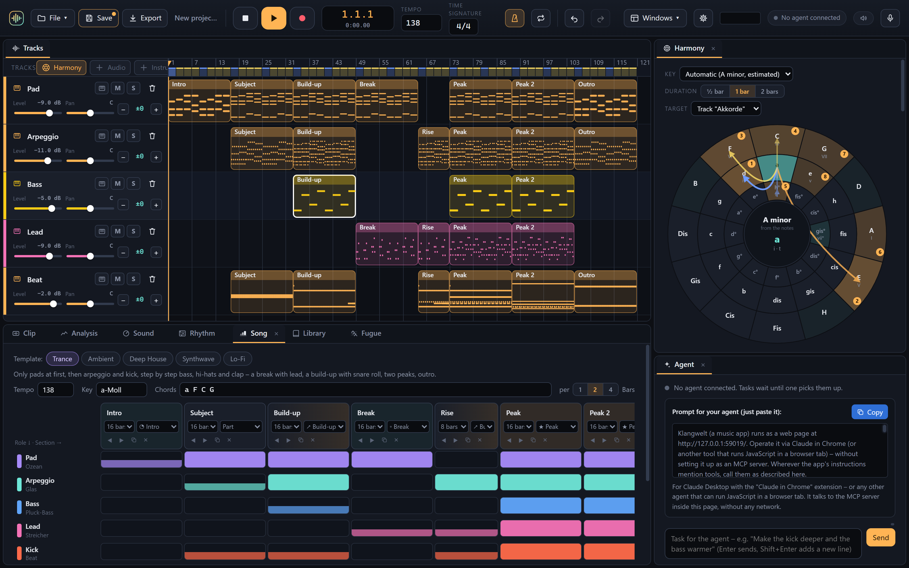
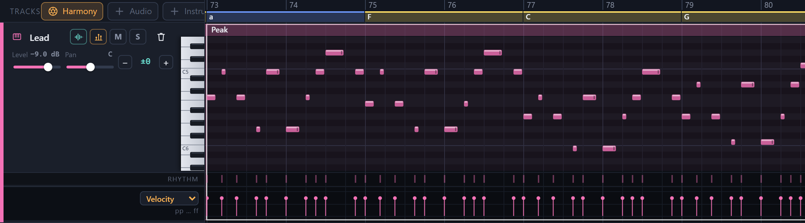
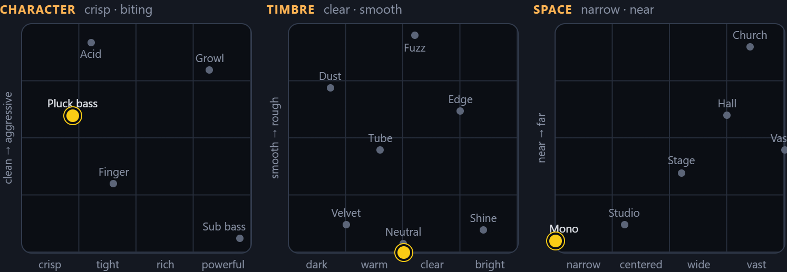
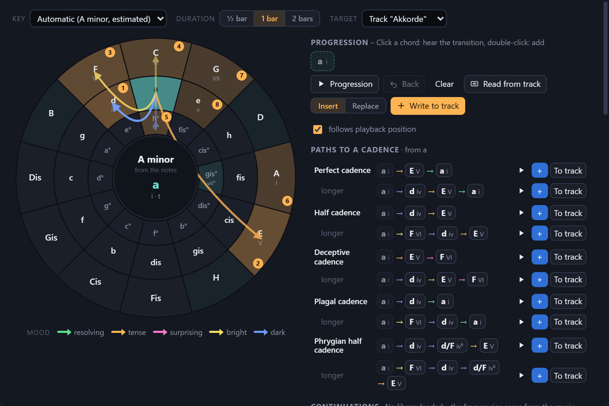

# Klangwelt

**Make music in your browser – no installation, no account, no server.**

### [▶ Open Klangwelt in your browser](https://devfunke.github.io/klangwelt/)

Prefer a program on your computer? → [Klangwelt Desktop](https://github.com/DevFunke/klangwelt-desktop)

---

Klangwelt is a tool for making music: lay down tracks, write and record
melodies, shape sounds, find harmonies, build a fugue – and take it all home
as an audio file. The web version is not a trimmed-down preview: the browser
runs **the same core as the desktop app**, written in Rust and compiled to
WebAssembly. Sound is generated in real time on your own machine.



The app speaks English, German, French, Italian, Spanish, Dutch and Polish –
it follows your browser's language, and the gear menu switches it.

It also works on phones and tablets: on a small screen the tracks stay on top
and the other windows become tabs below them; fingers move and zoom the
timeline, a long press opens the context menu, a double tap adds a note.

## What you can do with it

* **Tracks and notes** – multitrack editing with a piano roll, tempo and
  meter, loop, metronome; expression per note (velocity, articulation);
  everything undoable.
* **Shape sounds** – instruments from synth, bass and organ to drums, plus a
  sound workshop with descriptive controls ("warmer", "brighter", "more
  room") and your own saved sounds.
* **Rhythm and song** – program drums on a grid, or let templates build a
  whole song with verse, chorus and bridge.
* **Harmony** – circle of fifths, suggestions for the next chord, chord
  progressions with mood and twists, a harmony timeline above the piece.
* **Fugue and counterpoint** – pick a subject, find countersubjects, let the
  voices enter; a checker points out parallel fifths and other mistakes.
* **Record and recognize** – play or sing into the microphone; while you
  record, a live analysis shows the note you're singing (tuner-style), the
  level, and soon the key and tempo. Afterwards Klangwelt detects tempo, key
  and melody – with how you played it: dynamics, accents and sforzati,
  staccato and legato – and turns a recording into a melody or drum track
  that keeps all of that.
* **Score library** – more than 76,000 free scores (public domain and CC0,
  from PDMX and OpenScore). Search by title, composer or melody – type the
  notes, take them from a clip or simply sing them – or browse by genre,
  composer and mood. Listen to a score and take a voice or a section into
  your tracks. Your own MusicXML files join the search, too.
* **Audio files** – just drag WAV, AIFF, FLAC or Opus into the window.
* **Export** – WAV, FLAC, Opus (small, for your phone), individual stems or
  MIDI – as a download.
* **With an AI agent** – Klangwelt ships its own tools for agents (MCP). The
  agent window has a ready-made prompt for Claude with the "Claude in Chrome"
  extension; then you simply type requests like "make the bass warmer" into
  the app's chat.

## A closer look

**Notes as a piano roll** – the lead melody at the song's peak, its chords
in the harmony band above (coloured by mood), the rhythm and velocity lanes
below.



**Sound fields for the bass** – character, timbre and space as three fields.
Each dot is a preset (Acid, Growl, Pluck bass, Finger, Sub bass …), the yellow
point is the current sound: drag it anywhere in between.



**Circle of fifths** – the key of the piece, where the chords lead and how
each step feels (the coloured arrows), and the classic paths to a cadence:
listen to them, then write them into a track with one click.



## Getting started

1. [Open Klangwelt](https://devfunke.github.io/klangwelt/) – Edge or Chrome
   work best.
2. **"Load demo"** plays a short piece with beat, arpeggio and melody – a good
   place to start exploring. The space bar starts and stops playback.
3. **Save** keeps the project in your browser's storage; it is still there on
   your next visit. "File → Download project file" downloads it as a file for
   backup or sharing (the desktop app opens it, too).
4. After your first visit, Klangwelt also works **offline**.

## Your data stays with you

There is no server doing the work, no account and no tracking. Projects,
recordings, your own sounds and your own scores live only in your browser's
storage; none of it is uploaded. The score library is a set of files on
[Zenodo](https://doi.org/10.5281/zenodo.24231431): your browser reads only the
parts a search or an opened score needs and keeps them, so what you have used
once also works offline. Klangwelt asks for the microphone only when you
record or sing a melody.

## Browser or desktop?

Both share the same interface and the same core. The
[desktop app](https://github.com/DevFunke/klangwelt-desktop) can additionally
do what a web page is not allowed to do, or cannot do well:

| | Browser | Desktop |
|---|---|---|
| Projects | in browser storage, download and upload as files | files on your computer, open by double-click |
| Score library (search by title or melody, also sung; browse; take voices into tracks) | ✓ | ✓ |
| Scores in the library | more than 76,000 free scores, read as you search; plus your own MusicXML files | download collections yourself (all of PDMX with 254,000 scores, KernScores, DCML …), several libraries |
| Choose audio devices (interface, headphones) | system default | ✓ |
| Agent | via Claude in Chrome or Playwright MCP (extension "Playwright MCP Bridge", also Vivaldi, Brave, Edge) – one prompt to copy | its own MCP endpoint, one prompt for Claude Code |
| Installation | none | a single file, no installer |

## For developers

This repository holds the shared core, the user interface and the browser
version. The desktop app includes it as a Git submodule.

| Folder | Contents |
|---|---|
| `crates/klang-core` | project model, commands, undo |
| `crates/klang-dsp` | our own signal processing: pitch, onsets, time stretching, synthesis |
| `crates/klang-music` | music theory, MusicXML, score library and melody search |
| `crates/klang-libbuild` | builds the browser's score library package from pinned sources |
| `crates/klang-engine` | mixer and audio engine (desktop: cpal, browser: AudioWorklet) |
| `crates/klang-mcp` | MCP protocol for agents |
| `crates/klang-opus` | libopus and the Ogg container for Opus export |
| `crates/klang-app` | the platform-independent core: state, UI commands, agent tools, export |
| `crates/klang-web`, `crates/klang-worklet` | browser shell (web worker) and the mixer in the AudioWorklet |
| `ui/` | user interface for desktop and browser – TypeScript without runtime libraries |

**Build and run locally** – needs Rust with the `wasm32-unknown-unknown`
target, Node and clang from LLVM (for libopus):

```bash
rustup target add wasm32-unknown-unknown
cd ui
npm ci
npm run build:web     # → ui/dist-web, a folder of static files
npm run serve:web     # → http://localhost:1420/
```

**Tests:**

```bash
cargo test --workspace
cd ui && npm run test:unit
cd ui && npm run build:web && npm run test:web   # headless Edge, muted
```

How the core, the browser shell and the desktop shell fit together is
described in [docs/ARCHITECTURE.md](docs/ARCHITECTURE.md); everything about the
browser version – including publishing to GitHub Pages – is in
[docs/WEB.md](docs/WEB.md), and how the score library package is built,
published and read is in [docs/LIBRARY.md](docs/LIBRARY.md).

## License

Klangwelt is free software under the [MIT License](LICENSE): free of charge
and usable for any purpose, without warranty. The third-party libraries built
into it (Rust crates and libopus) are under free licenses, see
[THIRD-PARTY-LICENSES.md](THIRD-PARTY-LICENSES.md). The app itself contains
no scores. The browser version reads the
[score library package on Zenodo](https://doi.org/10.5281/zenodo.24231431)
(CC BY 4.0, with attribution to PDMX and OpenScore); every score in it is in
the public domain or under CC0, and every hit shows its source and license.
Collections that the desktop app downloads from their sources come under
their own licenses. Klangwelt is an independent free project and
not affiliated with any companies, brands or institutions of the same name.
